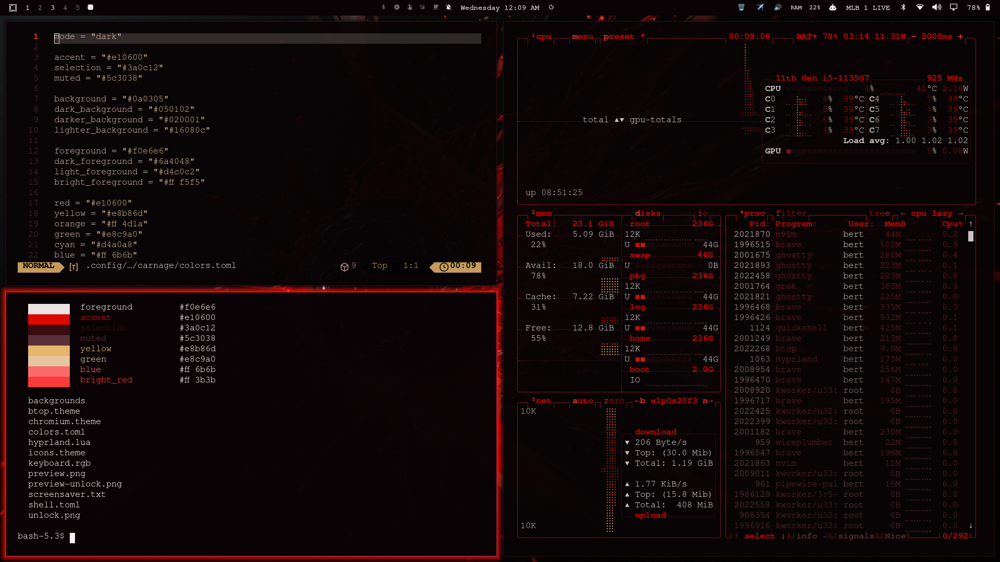

# Carnage

A void-black and blood-red theme for [Omarchy](https://omarchy.org).

Glossy black, wet crimson, and bone-white text. Window borders run a carnage-red gradient, the bar and launcher sit on near-black, and selected rows light up `#e10600`.



## Install

```bash
omarchy theme install https://github.com/Bert0424/omarchy-carnage-theme
```

Or from the Omarchy menu (`Super + Space`): **Install > Style > Theme**, then paste the repo URL.

## Palette

| Role | Color |
| --- | --- |
| background | `#0a0305` |
| foreground | `#f0e6e6` |
| accent | `#e10600` |
| selection | `#3a0c12` |
| muted | `#5c3038` |
| yellow / bone | `#e8b86d` |
| active border | `rgba(e10600ee) → rgba(8b1e2dee)` at 45° |

## What's in it

- **3 wallpapers** in the same black-orb / wet-red style (Red Drip, Red Bloom, Red Vortex)
- **Yaru-red** icons
- Custom **shell.toml** for bar, launcher, menus, notifications, and lock chrome
- Custom **btop** theme
- Optional **screensaver** wordmark in `screensaver.txt` (copy to `~/.config/omarchy/branding/screensaver.txt` if you want it)

## Uninstall

```bash
omarchy theme remove carnage
```

## License

MIT — see [LICENSE](LICENSE).
